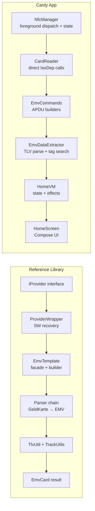

# Cardy vs EMV-NFC-Paycard-Enrollment — Approach Comparison

## Overview

| Aspect | EMV-NFC-Paycard-Enrollment (Reference) | Cardy (Our Implementation) |
|---|---|---|
| **Language** | Pure Java library | Kotlin + Jetpack Compose |
| **Architecture** | Library only — zero Android code | Full Android app with NFC lifecycle |
| **Responsibility** | Only EMV parsing + APDU orchestration | Everything: NFC lifecycle, EMV reading, vault, UI |
| **Transport abstraction** | `IProvider` interface | Direct `IsoDep.transceive()` in `CardReader` |
| **TLV parsing** | `TLVInputStream` (scuba lib) + `TlvUtil` | `libraries:tlv` module (custom KMP BER-TLV) |
| **Error recovery** | `ProviderWrapper` auto-handles SW_6C/SW_61 | ❌ Not implemented |
| **Card scheme detection** | AID prefix + IIN regex (28+ schemes) | AID prefix matching (7 networks) |
| **Track data** | Regex-based Track1/Track2 decode | Direct tag extraction (5A, 5F24, 5F20) |
| **PDOL handling** | Full terminal emulation via `ITerminal` | Zero-fill PDOL bytes |
| **AID discovery fallback** | PPSE → PSE → brute-force all known AIDs | PPSE only |

---

## 1. NFC Lifecycle & Intent Handling

### Reference Approach
The library has **no** NFC code. It documents what the caller must build:
- **Foreground dispatch** in `onResume`/`onPause`
- **`onNewIntent`** to extract `Tag` → `IsoDep`
- **`BroadcastReceiver`** for `ACTION_ADAPTER_STATE_CHANGED` to monitor NFC toggle

### Cardy Approach
- Foreground dispatch in `CardyActivity.onResume()`/`onPause()` ✅
- `onNewIntent` → `handleNfcIntent()` → `homeVM.onEvent(HandleNfcIntent)` ✅
- **BroadcastReceiver** registered in `NfcManager` for reactive NFC state ✅ (just added)
- **`nfcEnabledState: StateFlow<Boolean>`** observed by both Activity and ViewModel ✅

### Key Difference
The reference treats NFC as the caller's responsibility entirely. We integrated NFC state monitoring directly into `NfcManager` as a `StateFlow`, making it reactive without requiring manual `onResume` polling.

---

## 2. APDU Communication & Error Recovery

### Reference: ProviderWrapper
```java
// Automatically re-sends with corrected Le on SW_6C
// Automatically issues GET_RESPONSE on SW_61
byte[] ret = provider.transceive(pCommand);
if (isSW6C(ret)) { pCommand[Le] = ret[lastByte]; ret = provider.transceive(pCommand); }
if (isSW61(ret)) { ret = provider.transceive(GET_RESPONSE(ret[lastByte])); }
```
This is critical for real-world compatibility. Many cards respond with `6Cxx` (wrong Le) or `61xx` (more data available).

### Cardy: Raw Transceive
```kotlin
private fun transceive(isoDep: IsoDep, command: ByteArray): ApduResponse {
    val rawResponse = isoDep.transceive(command)
    return ApduResponse.from(rawResponse)
}
```
No automatic recovery for `6Cxx` or `61xx` status words.

### 🚨 Gap: Cardy should add SW_6C/SW_61 handling
Some cards will fail silently without this. This is likely contributing to "card read sound but nothing happens" — if the card responds with SW_6C to our initial PPSE SELECT, we treat it as a failure.

---

## 3. EMV Application Discovery

### Reference: 3-Tier Fallback
1. **PPSE** (`2PAY.SYS.DDF01`) — contactless directory
2. **PSE** (`1PAY.SYS.DDF01`) — contact directory (fallback)
3. **AID brute-force** — try all 28+ known scheme AIDs until one responds

### Cardy: PPSE Only
```kotlin
val ppseResponse = transceive(isoDep, EmvCommands.selectPpse())
if (!ppseResponse.isSuccess) error("PPSE selection failed")
```
If PPSE fails, we error out immediately with no fallback.

### 🚨 Gap: Cards that don't support PPSE
Some older or regional cards may not support PPSE. The reference's AID fallback mechanism would catch these.

---

## 4. GPO / PDOL Terminal Emulation

### Reference: Full Terminal Implementation
```java
// ITerminal provides real terminal data:
TTQ, Terminal Country, Currency, Date, Amount, Unpredictable Number
```
Each PDOL tag requested by the card gets a realistic response. The `Amount Authorised` = 0x01 is critical — some cards won't respond to GPO with zero amount.

### Cardy: Zero-Fill
```kotlin
private fun buildPdolData(pdolBytes: ByteArray): ByteArray {
    // Calculate total length needed, return all zeros
    return ByteArray(totalLength)
}
```

### 🚨 Gap: Cards requiring non-zero terminal data
Some cards (particularly Mastercard) reject GPO if `Amount Authorised` is zero or if `TTQ` doesn't indicate contactless support. This could cause cards to appear readable (PPSE succeeds) but return empty application data.

---

## 5. TLV Parsing

### Reference: `TLVInputStream` (scuba library)
- Streaming BER-TLV parser
- Handles multi-byte tags and multi-byte lengths correctly
- Recursive descent for constructed tags
- Battle-tested across thousands of card types

### Cardy: Custom `TLV.from()` from `libraries:tlv`
- KMP-compatible
- Manual offset management in `EmvDataExtractor.parseTlvData()`
- Known bug in `TLVList.from()` (always parses from offset 0) — worked around manually
- Parses one TLV at a time from subarray copies

### Comparison
Both approaches work, but the reference's `TLVInputStream` is more memory-efficient (no array copies) and has wider field testing. Our approach is functional but the subarray-copy pattern adds GC pressure during parsing.

---

## 6. Data Extraction Strategy

### Reference: Track Data Regex
```java
// Track 2: ([0-9]{1,19})D([0-9]{4})([0-9]{3})?(.*)
// Decodes PAN, expiry, service code from concatenated track bytes
```
Falls back through: Track2 (tag `57`) → Track1 → direct PAN tag (`5A`).

### Cardy: Direct Tag Extraction
```kotlin
val pan = findTag(allTlvs, "5A")?.value?.valueBytes?.toHex()
val expiry = findTag(allTlvs, "5F24")?.value?.valueBytes?.toHex()
val cardholderName = findTag(allTlvs, "5F20")?.value?.valueBytes
```
Only looks at specific tags, no Track2 fallback.

### 🚨 Gap: Cards that only provide Track2
Some cards (especially older Visa cards) provide PAN/expiry only in Track 2 Equivalent Data (tag `57`) and don't include tag `5A` separately. Cardy would miss the PAN on such cards.

---

## 7. Card Scheme Detection

### Reference: AID + IIN Regex (28+ schemes)
- Matches AID prefix first
- For co-branded cards (CB), re-checks by IIN range
- Supports: Visa, Mastercard, Amex, CB, Discover, JCB, UnionPay, ZIP, Rupay, Dankort, Maestro, Geldkarte, ELO, Cogeban, MIR, and more

### Cardy: 7 Networks
```kotlin
enum class CardNetwork { VISA, MASTERCARD, RUPAY, AMEX, DISCOVER, JCB, UNIONPAY, UNKNOWN }
```
- AID prefix matching only
- Covers the most common networks

---

## 8. Error Handling Philosophy

### Reference: Tolerant & Graceful
- Parsing failures result in `null` fields, not exceptions
- Transaction records parsed individually — one failure doesn't abort others
- Communication failures throw `CommunicationException` only
- Library logs via SLF4J at debug/warn level

### Cardy: Fail-Fast
```kotlin
fun readCard(isoDep: IsoDep): Result<CardReadResult> = runCatching {
    // If PPSE fails → error
    // If no AIDs → error
    // If no apps readable → error
}
```
Any step failure aborts the entire read.

### 🚨 Gap: Partial reads
If one AID on a multi-app card fails, the entire read aborts instead of returning partial data.

---

## 9. Recommended Improvements for Cardy

| Priority | Improvement | Effort | Impact |
|---|---|---|---|
| **P0** | Add SW_6C/SW_61 handling in `transceive()` | Low | Fixes many "card tap does nothing" cases |
| **P0** | Add Track 2 (tag `57`) fallback for PAN extraction | Low | Catches cards without tag `5A` |
| **P1** | Non-zero PDOL: set Amount=1, proper TTQ | Medium | Fixes Mastercard & some Visa GPO rejections |
| **P1** | AID fallback when PPSE fails | Medium | Supports older/regional cards |
| **P2** | PSE fallback (contact-mode support) | Low | Niche — most NFC cards support PPSE |
| **P2** | Partial read tolerance (don't abort on single app failure) | Low | Better UX for multi-app cards |
| **P3** | GET DATA commands (ATC, PIN tries, log format) | Medium | Richer card info display |
| **P3** | Transaction log reading | Medium | Power user feature |

---

## 10. Architecture Comparison Summary



### Key Architectural Difference
The reference separates **transport** from **protocol** from **parsing** via interfaces. Cardy combines transport + protocol in `CardReader` directly, which is simpler but less testable and doesn't allow the transparent error recovery that `ProviderWrapper` provides.

---

## 11. What Cardy Does Better

| Aspect | Why it's better |
|---|---|
| **Reactive NFC state** | `StateFlow<Boolean>` vs manual BroadcastReceiver management |
| **Modern stack** | Kotlin coroutines, Compose, type-safe navigation |
| **Integrated security** | Biometric auth + AES-256 vault (reference has no storage) |
| **Single codebase** | NFC → parse → store → display in one module |
| **KMP TLV library** | Can share TLV parsing across platforms |
