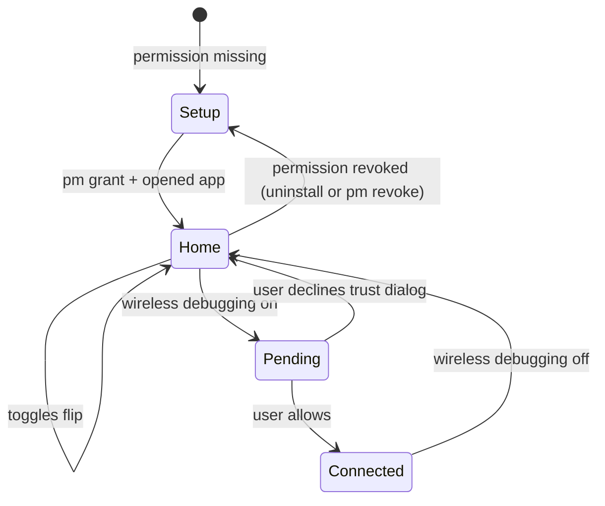

> Context: [Main](../../context.md) > [Devinator](./context.md) > Design

# Devinator — Design & Behaviour

How the app behaves. What it looks like lives in [ui.md](./ui.md); why the mechanism works at all
lives in [context.md](./context.md).

## Principles

1. **One tap per switch.** After setup there are no wizards, no nested screens, no confirmation for
   anything reversible.
2. **Never lie about state.** The UI renders what the settings database says, not what the user
   last tapped. A rejected write looks rejected.
3. **Android's security gates stay visible.** We trigger the trust dialog; we never route around it
   and never pretend it is our own prompt.
4. **No confirmation dialogs.** Turning developer options off zeroes USB and wireless debugging but
   remembers their values; turning it back on restores them. A failed write is a snackbar, never a
   modal.
5. **Local only.** No telemetry, no analytics, no outbound requests, no data collected. `INTERNET`
   arrives transitively with `:core:commons` (see [context.md](./context.md#build--manifest)); it is
   never used to reach a server, so the app's promise is about behaviour, not the permission list.

## States

| State | What the user sees |
|---|---|
| `Setup` | Guided one-time permission screen; Home is not reachable |
| `Home` | Developer options hero, USB and wireless cards, live values |
| `Pending` | Wireless card header shows a spinner and "Confirm the system dialog" for up to ~3 s, then settles to whatever the key says |
| `Connected` | The wireless card shows the top-ranked address, the `adb connect` command and auto-off |
| Failure | Snackbar "Couldn't change this setting."; the switch stays wherever the settings database says |

**Developer options off** is not an error state even though the hero card turns red: red is the off
signal (green = on), a state marker rather than a failed write. The USB and wireless cards stay
visible but disabled with the reason attached, because `adbd` cannot run without developer options.

## Interactions

| Interaction | Result |
|---|---|
| Tap Developer options switch | Writes the key immediately |
| Turn Developer options **off** | Writes `0`, snapshots USB and wireless debugging, then zeroes them; no dialog |
| Turn Developer options **on** | Writes `1` and restores the values captured when it was turned off |
| Tap USB / Wireless switch | Writes the key immediately; no dialog of our own |
| Turn Wireless debugging on | Our write raises the system trust dialog; UI shows `Pending` until the key changes. The first time, Android also asks for local-network access — that grant only covers the mDNS port lookup, so declining still turns wireless debugging on and just leaves the port unknown |
| Turn Wireless debugging off | Silent, immediate; also cancels the auto-off timer |
| Tap the copy control on the endpoint | Copies `adb connect <ip>:<port>` for the address shown |
| Tap the Auto-off row | Menu: Off / 5 / 15 / 30 min. Default Off. The row's trailing value shows the current choice |
| Tap the tiles card on Home | Opens the Quick Settings Tiles page — a navigation, not an action |
| Tap a row on the Quick Settings Tiles page | Adds the tile via `StatusBarManager.requestAddTileService` (API 33+) if absent, removes it from the shell's list if present. The whole row is the target; there is no per-row button |
| Add a tile | The system shows its own "Add … to Control center" prompt; the row flips to `Remove` only once the shell's list contains it, so an add made from the system editor reads the same way |
| Remove a tile | Immediate, no dialog: the shell's list is rewritten without that entry |
| Tap "Grant or revoke" | Opens the Permission page: both `pm grant` and `pm revoke` commands, each with a copy control |
| Change Appearance | System / Light / Dark, plus a Dynamic colour switch. Both persist and repaint the app immediately; dynamic colour defaults off |
| Tap "Open Developer options" | Leaves for Android's own Developer options screen |
| Tap a tile | Same write as the corresponding switch; never opens the app |
| Long-press a tile | System behaviour (opens Settings tile placement) — do not override |

### Which address is primary

The phone cannot see the computer's network, so "which address can I use" is answered by a ranked
best guess:

1. **Wi-Fi** — the interface carrying the phone's active network. A computer on the same router is
the overwhelmingly common case.
2. **Hotspot** — the phone's own AP address; reachable only by a machine joined to that hotspot, and
the only candidate when the phone is tethered and off Wi-Fi.
3. **VPN** — a tunnel address rarely routes from another machine, and mDNS does not cross the tunnel.
4. **Other** — anything left.

Only the first candidate is drawn: **one address and one port, like Android's own wireless debugging
screen**. The network pill names the network the computer must be on; there is no second row. This
replaces an earlier rule that put VPN first (a VPN being up does not stop the Wi-Fi address from
working, so promoting it only produced a dead end) and an interim rule that showed an alternate.

All candidates share **one port** — adbd runs a single TLS listener and advertises
`_adb-tls-connect._tcp` on every interface at that port. Several addresses can reach it depending on
which network the computer is on, but the port never differs, so a second row was never a choice of
transport. If the fallback is ever needed, it belongs behind the network pill, not on the card.

### Timer rules

- Armed only while wireless debugging is on, from the moment the key reads `1`.
- Countdown is visible in the wireless card ("turns off in 12:04") — a timer nobody sees is a
  surprise, and a surprise port is a lost session.
- Manual off cancels it; manual on re-arms it; process death or reboot loses it (accepted).
- Default `Off`: a timer is opt-in, so the port cannot change under a session unless the user asked
  for it.

## Edge cases

| Case | Behaviour |
|---|---|
| System dialog declined | No error state. Toggle returns to off; `Pending` fades; neutral snackbar "Wireless debugging not confirmed" |
| Write throws (OEM restriction) | Snackbar "Couldn't change this setting."; the switch stays where the database says |
| Permission revoked while running | Next write fails → route to `Setup` on the next resume |
| Port discovery finds nothing | Endpoint shows address only, plus "port is on the Developer options screen" |
| No network | The wireless card's endpoint row shows "No network" and the command block is hidden; the toggle still works (hotspot and VPN count as networks) |
| Multiple addresses | Show the top-ranked one only: Wi-Fi first, then Hotspot, VPN last; never two ports |
| Developer options re-enabled | USB and wireless return to their pre-off values; wireless may raise the trust dialog again because adbd restarts |
| User changes settings in the Settings app | Values update live via the observer; no manual refresh |
| Airplane mode mid-session | Key stays `1`, endpoint empties, card states why |

## Copy rules

- Toggle captions name the transport, not the API: "ADB over USB", "ADB over Wi-Fi or hotspot".
  Developer options gets the dependency instead, because that is what the row is for: "Master switch
  for ADB".
- An endpoint line names the network the **computer** must be on, not the phone's interface: a reader
  who types the hotspot address from a laptop on the home Wi-Fi gets a timeout, not a hint.
- The permission is explained once, on setup: one line for what it is for, one for why granting it
  is safe — no scare wording, no legalese.
- Never surface a raw exception, a stack trace, or an internal key name in the UI. Key names belong
  in [context.md](./context.md).
- Empty and pending states say what is happening, not "Loading…".

## Out of scope (v1)

Zero-permission shelf (special-access deep links, package/activity inspector, device info), Shizuku
and root grants, logcat viewer, density/size overrides, widgets, dynamic shortcuts, extra
`Settings.Global` toggles (animation scales, show taps, pointer location). The architecture leaves
room: any new tool is another entry in the same repository pattern, and the tiles are the model for
adding an entry point.

## Related Context

- [Module context](./context.md) — keys, permission, write path, risks
- [UI spec](./ui.md) — screens, components, copy, tokens
