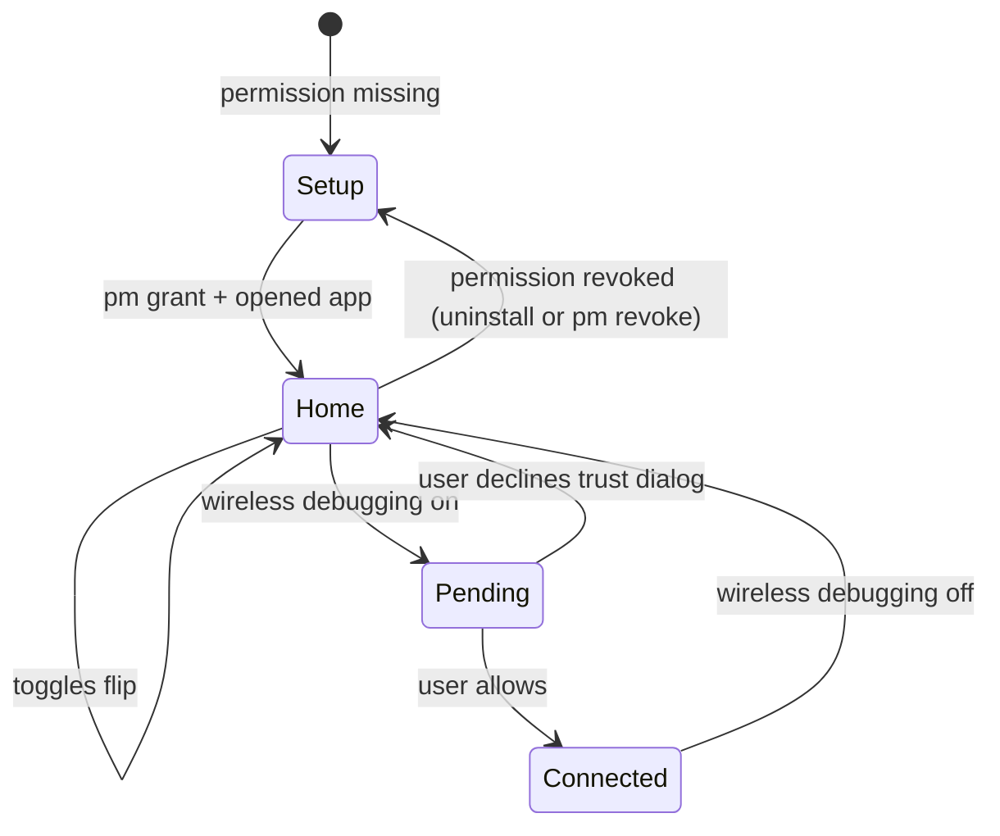

> Context: [Main](../../context.md) > [Devinator](./context.md) > Design

# Devinator — Design & Behaviour

How the app behaves. What it looks like lives in [ui.md](./ui.md); why the mechanism works at all
lives in [context.md](./context.md).

## Principles

1. **One tap per switch.** After setup there are no wizards, no nested screens, no confirmation for
   anything reversible.
2. **Never lie about state.** The UI renders what the settings database says, not what the user
   last tapped. A rejected write looks rejected.
3. **Android's security gates stay visible.** We trigger the trust dialog; we never route around it
   and never pretend it is our own prompt.
4. **The one destructive action asks.** Turning developer options off can kill a session someone is
   in the middle of; everything else is silent.
5. **Local only.** No telemetry, no analytics, no outbound requests, no data collected. `INTERNET`
   arrives transitively with `:core:commons` (see [context.md](./context.md#build--manifest)); it is
   never used to reach a server, so the app's promise is about behaviour, not the permission list.

## States

| State | What the user sees |
|---|---|
| `Setup` | Guided one-time permission screen; Home is not reachable |
| `Home` | Three switches, live values |
| `Pending` | Wireless row shows a spinner and "Confirm the system dialog" for up to ~3 s, then settles to whatever the key says |
| `Connected` | Endpoint card appears with `adb connect` lines |
| Failure | Inline banner above the switches with a retry action; the switch snaps back |

**Developer options off** is not an error state: USB and Wireless rows stay visible but disabled with
the reason attached, because `adbd` cannot run without developer options.

## Interactions

| Interaction | Result |
|---|---|
| Tap Developer options switch | Writes the key immediately |
| Turn Developer options **off** | Confirmation dialog, "Also turn off USB and wireless debugging" pre-checked, affirmative button in error colour |
| Tap USB / Wireless switch | Writes the key immediately; no dialog of our own |
| Turn Wireless debugging on | Our write raises the system trust dialog; UI shows `Pending` until the key changes |
| Turn Wireless debugging off | Silent, immediate; also cancels the auto-off timer |
| Tap an endpoint line | Copies `adb connect <ip>:<port>` |
| Tap the timer chip | Menu: 5 / 15 / 30 min / Off. Default 30 min |
| Tap "Add tiles" | `requestAddTileService` on API 33+; on older APIs, caption explaining manual add |
| Tap a tile | Same write as the corresponding switch; never opens the app |
| Long-press a tile | System behaviour (opens Settings tile placement) — do not override |

### Timer rules

- Armed only while wireless debugging is on, from the moment the key reads `1`.
- Countdown is visible in the wireless card ("turns off in 12:04") — a timer nobody sees is a
  surprise, and a surprise port is a lost session.
- Manual off cancels it; manual on re-arms it; process death or reboot loses it (accepted).
- Default 30 min: long enough for a working session, short enough to matter.

## Edge cases

| Case | Behaviour |
|---|---|
| System dialog declined | No error. Toggle returns to off; `Pending` fades; no toast |
| Write throws (OEM restriction) | Banner: setting could not be changed + "Open Developer options" |
| Permission revoked while running | Next write fails → route to `Setup` on the next resume |
| Port discovery finds nothing | Endpoint shows address only, plus "port is on the Developer options screen" |
| No network | Endpoint card shows "No network" and stays empty; the toggle still works (hotspot and VPN count as networks) |
| Multiple addresses | Wi-Fi, VPN, Hotspot in that order; VPN first when a VPN is up |
| User changes settings in the Settings app | Values update live via the observer; no manual refresh |
| Airplane mode mid-session | Key stays `1`, endpoint empties, card states why |

## Copy rules

- Toggle captions name the transport, not the API: "ADB over cable", "ADB over Wi-Fi".
- The permission is explained once, on setup, in one sentence — no scare wording, no legalese.
- Never surface a raw exception, a stack trace, or an internal key name in the UI. Key names belong
  in [context.md](./context.md).
- Empty and pending states say what is happening, not "Loading…".

## Out of scope (v1)

Zero-permission shelf (special-access deep links, package/activity inspector, device info), Shizuku
and root grants, logcat viewer, density/size overrides, widgets, dynamic shortcuts, extra
`Settings.Global` toggles (animation scales, show taps, pointer location). The architecture leaves
room: any new tool is another entry in the same repository pattern, and the tiles are the model for
adding an entry point.

## Related Context

- [Module context](./context.md) — keys, permission, write path, risks
- [UI spec](./ui.md) — screens, components, copy, tokens
