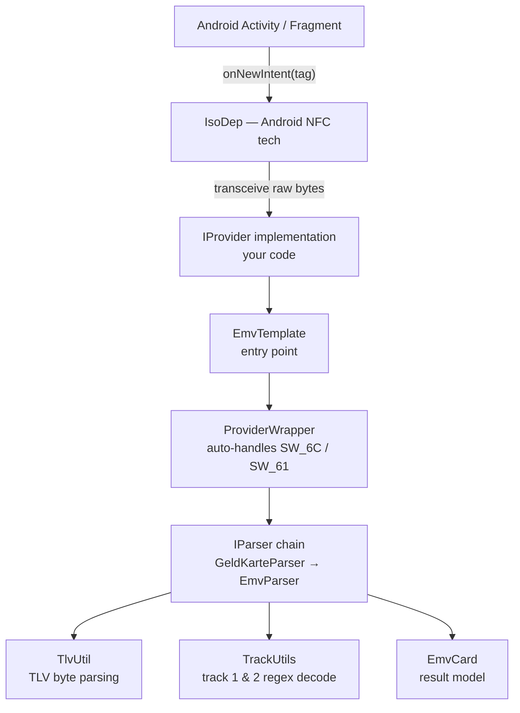
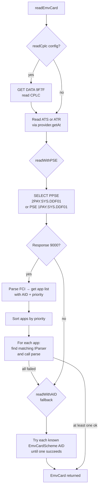
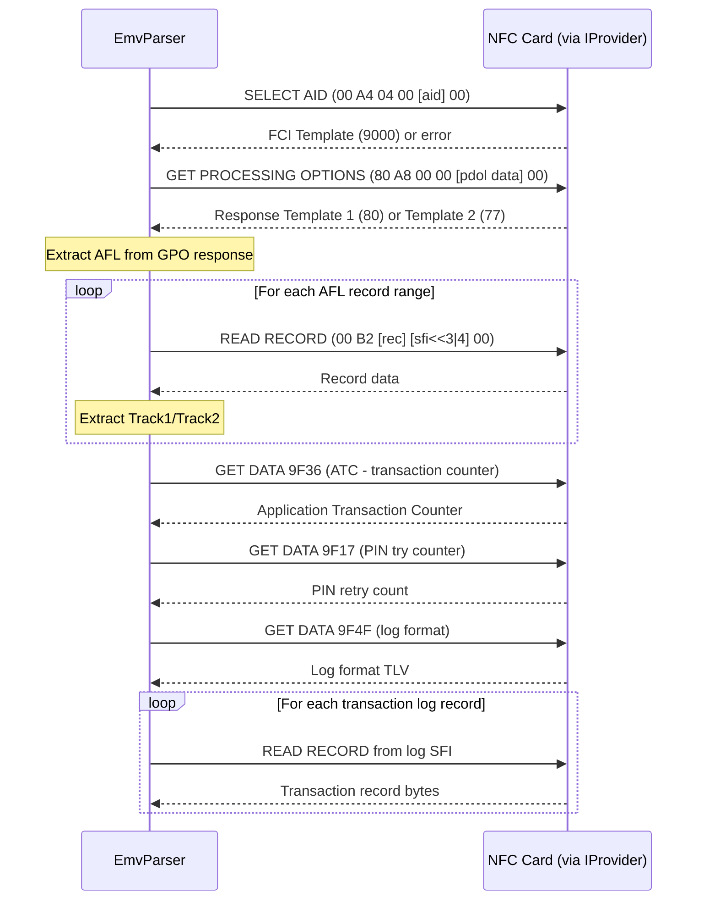
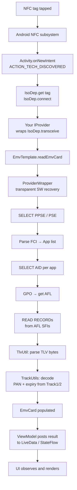

# EMV NFC Paycard Enrollment — Technical Reference

> Source: [devnied/EMV-NFC-Paycard-Enrollment](https://github.com/devnied/EMV-NFC-Paycard-Enrollment)  
> Language: Java (pure library — no Android-specific code in this repo)  
> Purpose: Read and extract public data from NFC EMV contactless payment cards

---

## 1. What This Library Is (and Isn't)

This is a **pure Java parsing library**. It has **no NFC setup code**, no `NfcAdapter`, no foreground dispatch, no `BroadcastReceiver`, no ViewModel, and no Activity lifecycle awareness. All of that is the **caller's responsibility**.

The library exposes a single clean seam: the `IProvider` interface. You hand it a transport that can send/receive raw APDU bytes, and it does all the EMV protocol work. On Android, that transport is built on top of `IsoDep`; on desktop it's built on `javax.smartcardio`.

---

## 2. High-Level Architecture



---

## 3. The Provider Contract — `IProvider`

```java
public interface IProvider {
    // Send a raw APDU command byte[], receive the card's response byte[]
    byte[] transceive(byte[] pCommand) throws CommunicationException;

    // Return the card's ATS (NFC-A historical bytes) or ATR (contact)
    byte[] getAt();
}
```

This is **the only thing you implement**. Everything else is handled by the library.

### Android `IsoDep` implementation (from README)

```java
public class Provider implements IProvider {
    private IsoDep mTagCom;

    @Override
    public byte[] transceive(final byte[] pCommand) throws CommunicationException {
        try {
            return mTagCom.transceive(pCommand);
        } catch (IOException e) {
            throw new CommunicationException(e.getMessage());
        }
    }

    @Override
    public byte[] getAt() {
        return mTagCom.getHistoricalBytes(); // NFC-A
        // return mTagCom.getHiLayerResponse(); // NFC-B
    }

    public void setmTagCom(IsoDep mTagCom) {
        this.mTagCom = mTagCom;
    }
}
```

### PC/SC desktop implementation (`PcscProvider`)

```java
// Uses javax.smartcardio CardChannel
channel.transmit(ByteBuffer.wrap(pCommand), buffer);
// ATR from card.getATR().getBytes()
```

Both implementations are interchangeable — the library can't tell the difference.

---

## 4. `ProviderWrapper` — Transparent APDU Error Recovery

The library never exposes the raw `IProvider` to parsers directly. It wraps it in `ProviderWrapper`, which silently handles two ISO 7816 status word edge cases:

| SW received | Meaning | Recovery action |
|---|---|---|
| `SW_6C xx` | Wrong Le length | Re-send same command with `Le = xx` |
| `SW_61 xx` | Response pending | Issue `GET_RESPONSE` to fetch the remaining `xx` bytes |

```java
public byte[] transceive(byte[] pCommand) throws CommunicationException {
    byte[] ret = provider.transceive(pCommand);
    if (ResponseUtils.isEquals(ret, SwEnum.SW_6C)) {
        pCommand[pCommand.length - 1] = ret[ret.length - 1]; // patch Le
        ret = provider.transceive(pCommand);
    } else if (ResponseUtils.isEquals(ret, SwEnum.SW_61)) {
        ret = provider.transceive(
            new CommandApdu(CommandEnum.GET_RESPONSE, null, ret[ret.length - 1]).toBytes()
        );
    }
    return ret;
}
```

This means **you don't need to handle these status words in your provider**.

---

## 5. Entry Point — `EmvTemplate`

`EmvTemplate` is the facade. You build one, call `readEmvCard()`, get back an `EmvCard`.

### Builder pattern

```java
EmvTemplate parser = EmvTemplate.Builder()
    .setProvider(provider)          // required
    .setConfig(EmvTemplate.Config() // optional, shown with defaults
        .setContactLess(true)       // PPSE vs PSE directory selection
        .setReadAllAids(true)       // parse all apps on the card
        .setReadTransactions(true)  // read transaction log
        .setReadCplc(false)         // CPLC chip lifecycle data
        .setReadAt(true)            // read ATS/ATR
    )
    // .setTerminal(customTerminal) // optional, for custom GPO PDOL construction
    .build();

EmvCard card = parser.readEmvCard();
```

### `readEmvCard()` execution flow



---

## 6. Application Discovery — PSE / PPSE / AID Fallback

### Step 1: PPSE (contactless) or PSE (contact)

```
SELECT "2PAY.SYS.DDF01"  (PPSE, contactless)
SELECT "1PAY.SYS.DDF01"  (PSE, contact)
```

Response contains an FCI template. The library walks its SFI records, extracting `Application Template` (tag `61`) structures, each containing:
- **AID** (tag `4F`) — the application identifier
- **Application Label** (tag `50`) — human-readable name
- **Priority Indicator** (tag `87`) — used to sort apps

### Step 2: AID Fallback

If PPSE/PSE fails (card doesn't support it, or no readable apps found), the library tries every known scheme AID from `EmvCardScheme`:

```java
// 28+ known schemes, e.g.:
VISA("VISA", "^4[0-9]{6,}$",
    "A0 00 00 00 03", "A0 00 00 00 03 10 10", "A0 00 00 00 98 08 48")
MASTER_CARD("Master card", ..., "A0 00 00 00 04", "A0 00 00 00 05", ...)
AMERICAN_EXPRESS(..., "A0 00 00 00 25")
GELDKARTE(..., "D2 76 00 00 25 45 50 02 00", ...)
// ... 24 more
```

---

## 7. The Parser Chain — `IParser`

```java
public interface IParser {
    Pattern getId();           // regex matched against app AID hex string
    boolean parse(Application pApplication) throws CommunicationException;
}
```

Two default parsers are registered, checked in order:

| Parser | `getId()` pattern | Purpose |
|---|---|---|
| `GeldKarteParser` | Matches GeldKarte/ZKA AIDs | German electronic cash cards |
| `EmvParser` | `.*` (matches everything) | Standard EMV / contactless cards |

Custom parsers can be prepended via `emvTemplate.addParsers(myParser)`.

---

## 8. EMV Card Reading — `EmvParser` Deep Dive

### SELECT AID → GPO → AFL → Records



### APDU Construction — `CommandApdu`

```java
// SELECT AID
new CommandApdu(CommandEnum.SELECT, aidBytes, 0).toBytes()
// → [00 A4 04 00] [Lc] [aid...] [00]

// READ RECORD — record index, SFI encoded in P2
new CommandApdu(CommandEnum.READ_RECORD, recordIndex, sfi << 3 | 4, 0).toBytes()
// → [00 B2] [rec] [sfi<<3|4] [00]

// GPO
new CommandApdu(CommandEnum.GPO, pdolData, 0).toBytes()
// → [80 A8 00 00] [Lc] [83 len pdol...] [00]
```

All commands follow ISO 7816-4 Case 3/4 APDU format: `[CLA INS P1 P2 (Lc Data) Le]`.

---

## 9. TLV Parsing — `TlvUtil`

EMV responses are **BER-TLV encoded** (Basic Encoding Rules, Tag-Length-Value). `TlvUtil` provides the parsing layer:

```java
// Extract a single tag value anywhere in the TLV tree (recursive)
byte[] pan = TlvUtil.getValue(responseBytes, EmvTags.PAN);

// Extract multiple specific tags (returns list of TLV objects)
List<TLV> list = TlvUtil.getlistTLV(responseBytes,
    EmvTags.AID_CARD, EmvTags.APPLICATION_LABEL, EmvTags.APPLICATION_PRIORITY_INDICATOR);

// Parse a DOL (Data Object List) — list of tag+length pairs with no values
List<TagAndLength> pdolItems = TlvUtil.parseTagAndLength(pdolBytes);
```

Internally uses `TLVInputStream` from the `scuba` library. The parser is **recursive** — when it encounters a constructed tag (one that contains nested TLVs), it recursively dives in to find the target tag.

### Key EMV Tags

| Tag | Name | Used for |
|---|---|---|
| `57` | Track 2 Equivalent Data | Card number, expiry |
| `5A` | PAN | Card number (alternate source) |
| `5F20` | Cardholder Name | Holder name |
| `5F24` | App Expiration Date | Card expiry |
| `6F` | FCI Template | PPSE/PSE select response wrapper |
| `70` | Record Template | READ RECORD response wrapper |
| `77` | Response Template 2 | GPO response (tagged) |
| `80` | Response Template 1 | GPO response (untagged) |
| `84` | Dedicated File Name | Selected AID |
| `94` | AFL | Application File Locator |
| `9F36` | ATC | Application Transaction Counter |
| `A5` | FCI Proprietary Template | Nested in `6F` |

---

## 10. Track Data Extraction — `TrackUtils`

After reading records, the parser calls `TrackUtils` to decode the raw bytes into structured objects using regex:

### Track 2 (most common)

```
Pattern: ([0-9]{1,19})D([0-9]{4})([0-9]{3})?(.*)
Example: 4111111111111111D2512201xxxxxxxxxx
          └── PAN ──────────┘ └expiry┘└svc┘
```

Extracts: PAN, expiry date (last day of month), service code.

### Track 1

```
Pattern: %?([A-Z])([0-9]{1,19})...^([^\\^]{2,26})^([0-9]{4})...
Extracts: format code, PAN, cardholder name (LASTNAME/FIRSTNAME), expiry, service code
```

---

## 11. Card Scheme Detection — `EmvCardScheme`

After reading, the library identifies the card network:

```java
// First check by AID prefix
EmvCardScheme type = EmvCardScheme.getCardTypeByAid(selectedAid);

// If CB (French Cartes Bancaires), re-check by card number IIN range
// (CB cards can be VISA or Mastercard underneath)
if (type == EmvCardScheme.CB) {
    type = EmvCardScheme.getCardTypeByCardNumber(cardNumber);
}
```

Each scheme carries a regex for BIN/IIN matching:
- Visa: `^4[0-9]{6,}$`
- Mastercard: `^5[1-5][0-9]{5,}$`
- Amex: `^3[47][0-9]{5,}$`
- UnionPay: `^62[0-9]{14,17}`

---

## 12. Terminal Values — `ITerminal` / `DefaultTerminalImpl`

Some cards require a **PDOL** (Processing Data Object List) in the GPO command — the card tells you which terminal data it needs. `ITerminal.constructValue(TagAndLength)` provides those values.

The default implementation (`DefaultTerminalImpl`) supplies:
- `TTQ` (Terminal Transaction Qualifiers) — all capabilities enabled
- `Terminal Country Code` — France (0250) by default, settable
- `Transaction Currency Code` — EUR (978)
- `Transaction Date` — today
- `Transaction Type` — Purchase
- `Amount Authorised` — 0x01 (minimal amount to trigger read mode)
- `Unpredictable Number` — `SecureRandom` generated

This is enough to pass the card's PDOL requirements and trigger data exposure without initiating a real payment.

---

## 13. Result Model — `EmvCard`

```java
EmvCard card = parser.readEmvCard();

card.getCardNumber()      // from Track2 then Track1 (PAN)
card.getExpireDate()      // java.util.Date, last day of expiry month
card.getHolderLastname()  // from Track1 or CARDHOLDER_NAME tag
card.getHolderFirstname() // from Track1
card.getType()            // EmvCardScheme (VISA, MASTER_CARD, etc.)
card.getState()           // ACTIVE, LOCKED, UNKNOWN
card.getAt()              // ATS/ATR hex string
card.getAtrDescription()  // human-readable chip description
card.getApplications()    // List<Application> with AID, label, left PIN tries, ATC, transactions
card.getBic()             // Bank Identifier Code (if present)
card.getIban()            // IBAN (if present)
card.getCplc()            // CPLC chip lifecycle data (if readCplc=true)
```

`Application` objects carry per-app data:
```java
app.getAid()
app.getApplicationLabel()      // e.g. "VISA CREDIT"
app.getLeftPinTry()            // remaining PIN attempts
app.getTransactionCounter()    // ATC value
app.getListTransactions()      // List<EmvTransactionRecord>
```

---

## 14. Error Handling

| Exception | When thrown |
|---|---|
| `CommunicationException` | `IProvider.transceive()` fails (your code throws this) |
| `TlvException` | Malformed TLV data encountered during parsing |

The library is fairly tolerant: most parsing failures result in `null` fields on the model rather than thrown exceptions. Transaction parsing errors per-record are caught and logged, not propagated.

---

## 15. What You Must Build for Android (Not in This Library)

This library gives you the parsing engine. For a complete Android integration, you need to build:

### A. NFC Foreground Dispatch Setup (in Activity)

```kotlin
// onCreate / onResume
val adapter = NfcAdapter.getDefaultAdapter(this)
val intent = Intent(this, javaClass).addFlags(Intent.FLAG_ACTIVITY_SINGLE_TOP)
val pendingIntent = PendingIntent.getActivity(this, 0, intent, PendingIntent.FLAG_MUTABLE)
val techFilters = arrayOf(arrayOf(IsoDep::class.java.name))
adapter.enableForegroundDispatch(this, pendingIntent, null, techFilters)

// onPause
adapter.disableForegroundDispatch(this)
```

### B. Intent Handling (in Activity)

```kotlin
override fun onNewIntent(intent: Intent) {
    super.onNewIntent(intent)
    if (NfcAdapter.ACTION_TECH_DISCOVERED == intent.action ||
        NfcAdapter.ACTION_TAG_DISCOVERED == intent.action) {
        val tag = intent.getParcelableExtra<Tag>(NfcAdapter.EXTRA_TAG)
        val isoDep = IsoDep.get(tag) ?: return
        // hand off to reading logic (ViewModel / coroutine)
        viewModel.readCard(isoDep)
    }
}
```

### C. Async Card Reading (ViewModel / coroutine)

```kotlin
fun readCard(isoDep: IsoDep) {
    viewModelScope.launch(Dispatchers.IO) {
        isoDep.connect()
        try {
            provider.setIsoDep(isoDep)
            val config = EmvTemplate.Config()
                .setContactLess(true)
                .setReadAllAids(true)
                .setReadTransactions(true)
            val template = EmvTemplate.Builder()
                .setProvider(provider)
                .setConfig(config)
                .build()
            val card = template.readEmvCard()
            _cardState.postValue(CardState.Success(card))
        } catch (e: CommunicationException) {
            _cardState.postValue(CardState.Error(e))
        } finally {
            isoDep.close()
        }
    }
}
```

### D. NFC Enable/Disable State Detection

The library has **no NFC state monitoring**. You need a `BroadcastReceiver`:

```kotlin
// Register in onResume, unregister in onPause
val nfcStateReceiver = object : BroadcastReceiver() {
    override fun onReceive(context: Context, intent: Intent) {
        val state = intent.getIntExtra(NfcAdapter.EXTRA_ADAPTER_STATE, NfcAdapter.STATE_OFF)
        when (state) {
            NfcAdapter.STATE_ON   -> _nfcEnabled.value = true
            NfcAdapter.STATE_OFF  -> _nfcEnabled.value = false
            NfcAdapter.STATE_TURNING_ON, NfcAdapter.STATE_TURNING_OFF -> { /* transitioning */ }
        }
    }
}
registerReceiver(nfcStateReceiver, IntentFilter(NfcAdapter.ACTION_ADAPTER_STATE_CHANGED))
```

---

## 16. Full Data Flow Summary



---

## 17. Key Design Patterns in the Library

| Pattern | Where | Why |
|---|---|---|
| **Strategy / Provider** | `IProvider`, `IParser` | Swap transport or parser without changing core logic |
| **Builder** | `EmvTemplate.Builder`, `EmvTemplate.Config` | Fluent, validated construction |
| **Decorator / Wrapper** | `ProviderWrapper` | Transparent APDU error recovery without touching parsers |
| **WeakReference** | `AbstractParser` holds `WeakReference<EmvTemplate>` | Parsers don't prevent template GC during long reads |
| **Chain of Responsibility** | Parser list in `EmvTemplate` | Try GeldKarte first, fall through to generic EMV |
| **Template Method** | `AbstractParser` + `EmvParser` | Common operations (selectAID, getLogEntry, etc.) in base, card-specific in subclass |

---

## 18. Dependencies

| Library | Purpose |
|---|---|
| `fr.devnied.bitlib` | Byte/bit manipulation utilities (`BytesUtils`) |
| `net.sf.scuba` | `TLVInputStream` — streaming BER-TLV decoder |
| `org.apache.commons-lang3` | `ArrayUtils`, `StringUtils`, `DateUtils` |
| `org.apache.commons-io` | `IOUtils.closeQuietly` |
| `org.slf4j` | Logging facade |

No Android dependencies — the library is pure Java and can run in unit tests on the JVM.
